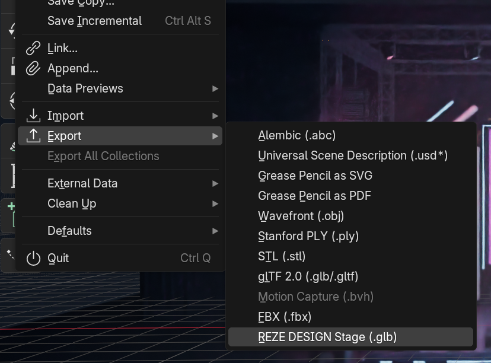

# REZE DESIGN Stage Export

Turns a Blender scene into a `.glb` stage for REZE DESIGN.

## Install

1. Download [`dist/reze_stage_export-1.0.1.zip`](dist/reze_stage_export-1.0.1.zip).
2. In Blender (4.2+): Edit → Preferences → Add-ons → ▾ (top right) → **Install from Disk…** → pick the zip.

## Use

1. In Blender: **File → Export → REZE DESIGN Stage (.glb)**.
2. In REZE DESIGN: Stage → **GLB file** → pick the `.glb`.

## What it adds to the .glb

- Lights, in REZE DESIGN's units
- Glowing surfaces (neon, LED strips, screens) as lights
- The room's ambient light and reflections
- The world (sky)
- Haze, as fog
- The colour look (AgX, Filmic, exposure)
- Bloom
- Baked procedural colours and ambient occlusion
- Instances, scatters and particles

---

# REZE DESIGN 舞台导出

把 Blender 场景导出为 REZE DESIGN 可用的 `.glb` 舞台。

## 安装

1. 下载 [`dist/reze_stage_export-1.0.1.zip`](dist/reze_stage_export-1.0.1.zip)。
2. 在 Blender（4.2+）中：编辑 → 偏好设置 → 插件 → ▾（右上角）→ **从磁盘安装…** → 选这个 zip。

## 使用

1. 在 Blender 中：**文件 → 导出 → REZE DESIGN Stage (.glb)**。
2. 在 REZE DESIGN 中：舞台 → **GLB 文件** → 选这个 `.glb`。

## 导出内容

- 灯光，换算成 REZE DESIGN 的单位
- 发光表面（霓虹、LED 灯带、屏幕）转为灯光
- 房间的环境光和反射
- 世界（天空）
- 雾气，转为距离雾
- 色彩风格（AgX、Filmic、曝光）
- 泛光（Bloom）
- 烘焙的程序化颜色和环境光遮蔽
- 实例、散布和粒子
